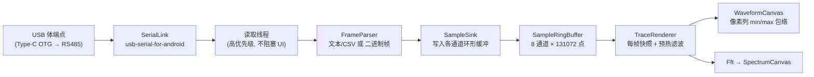

# RS485 示波器 (RS485Scope)

安卓端「串口示波器」：手机通过 **Type-C → RS485 OTG 模块** 与单片机 / 传感器 / 仪表通讯，
实时接收数据、下发指令、把数据画成波形，并可在显示前套用低通 / 高通 / 带通 / **陷波** / 均值 / 中值等滤波器。

- 语言：Kotlin + Jetpack Compose
- 最低系统：Android 8.0（API 26）
- 编译 SDK：37，目标 SDK：36

---

## 一、先看调研：GitHub 上有没有类似项目？

有，而且相当成熟。本项目**没有直接 fork 任何仓库**，而是复用其中被验证过的库与设计思路：

| 项目 | 星标 | 许可证 | 借鉴到的思路 |
| --- | --- | --- | --- |
| [mik3y/usb-serial-for-android](https://github.com/mik3y/usb-serial-for-android) | 5.7k | MIT | **直接作为依赖使用**。Android USB Host → 串口的驱动层，内置 CDC-ACM / CH34x / CP21xx / FTDI / PL2303 等驱动，覆盖市面上绝大多数 RS485 OTG 模块 |
| [kai-morich/SimpleUsbTerminal](https://github.com/kai-morich/SimpleUsbTerminal) | 734 | MIT | USB 权限申请流程、后台读取线程、插拔（ATTACHED / DETACHED）广播处理、独立读写线程不阻塞 UI |
| [wh201906/SerialTest](https://github.com/wh201906/SerialTest) | 1.6k | GPL-3.0 | 交互设计：数据收发 + 实时绘图 + 快捷发送面板的组合方式。**仅参考交互，未复制代码**（GPL 传染性） |
| [AleksandarDamnjanovic/Android-USB-Serial-Monitor-and-Plotter](https://github.com/AleksandarDamnjanovic/Android-USB-Serial-Monitor-and-Plotter) | 11 | Apache-2.0 | 串口监视 + 绘图二合一的思路 |
| [PhilJay/MPAndroidChart](https://github.com/PhilJay/MPAndroidChart) | 38k | Apache-2.0 | 调研后**放弃**：它是通用图表库，高频实时刷新（每秒数千点）时会掉帧，改用自绘 Canvas + 像素列 min/max 包络 |

**结论**：串口通讯层不必自己写，用 MIT 的 `usb-serial-for-android` 即可；
绘图层必须自绘；滤波算法用公开的 RBJ（Biquad）公式自行实现。

---

## 二、功能

**接收**
- 播放USB 设备枚举与驱动匹配、USB 权限申请、插拔自动检测
- 波特率 1200 ~ 2 Mbps（含自定义）、5~8 数据位、1/2 停止位、无/奇/偶/标记/空格校验、无/RTS-CTS/DTR-DSR/XON-XOFF 流控
- 可选「RTS 控制 RS485 收发方向」，适配把 DE/RE 接到 RTS 的半双工板子
- 后台独立读取线程，8 KB 读缓冲，25 ms 超时，不阻塞 UI

**发送**
- 文本（UTF-8）或十六进制两种模式
- 行尾可选 无 / LF / CR / CRLF
- 快捷发送按钮组（可增删）
- 周期发送（50 ~ 5000 ms）

**波形**
- 实时滚动波形，8 通道，每通道独立颜色 / 显示开关
- 自动量程（带平滑，避免跳变）或手动上下限
- 时基 128 ~ 8192 点（对数滑杆），并显示对应时间长度
- 网格、原始信号叠加对比
- 暂停 / 继续
- 采样率与吞吐实时统计

**滤波 / 陷波**
- 每通道独立滤波链，最多 6 级，可排序、可单独旁路
- 类型：低通、高通、带通、**陷波**、峰值 EQ、低架、高架、全通、滑动平均、中值、去直流
- 陷波可调中心频率、带宽、**陷波深度**（可只压一部分）
- 一键添加 50 Hz / 60 Hz 工频陷波
- 参数改动即时生效，**不会出现滤波器切换的瞬态毛刺**（见下文原理）

**频谱**
- 2048 点 Hann 窗 FFT，dB 幅度谱，用来验证陷波是否真的把那根谱线压下去了

**监视**
- 原始字节十六进制 / ASCII 显示，可暂停、自动滚底、清空

**测试**
- 30 个 JVM 单元测试覆盖环形缓冲、双二阶滤波器、陷波、FIR、FFT、文本/二进制协议解析、Hex 工具

---

## 三、架构与数据流



关键点：

1. **解码在读取线程，绘制在主线程**，两侧只通过环形缓冲交互，接收永远不会因为绘制慢而丢数据。
2. **滤波在渲染阶段做，不在接收阶段做**。每帧从环形缓冲取出「显示窗口 + 1024 点预热」的原始数据，
   重置滤波链并把预热段喂进去把状态"暖"起来，再输出窗口内的结果。
   这样用户拖动滤波器滑杆时波形立刻变化，且不会因为滤波器状态错乱而出现假波形。
3. **降采样用像素列 min/max 包络**，而不是简单抽点，窄脉冲不会被抽掉。

---

## 四、编译运行

### 方式一：Android Studio（推荐）

1. Android Studio 打开 `RS485Scope` 目录
2. 等待 Gradle Sync（会自动下载 AGP / Kotlin / Compose / usb-serial-for-android）
3. 连接手机（打开 USB 调试）→ Run

### 方式二：命令行

```bash
cd RS485Scope
# 需要 JDK 17+ 与 Android SDK（ANDROID_HOME 或 local.properties 指向 SDK）
./gradlew :app:assembleDebug
# 产物: app/build/outputs/apk/debug/app-debug.apk
```

### 版本说明（重要）

本工程使用 **AGP 9.4.1 + Gradle 9.8.1 + Kotlin 2.4.21**，写在 `gradle/libs.versions.toml` 里。
AGP 9 起 **Kotlin 支持已内建**，所以 `app/build.gradle.kts` 里**只应用了 `com.android.application` 和
`org.jetbrains.kotlin.plugin.compose`，不能也不需要再应用 `org.jetbrains.kotlin.android`**
（若加上会直接报 `The 'org.jetbrains.kotlin.android' plugin is no longer required since AGP 9.0`）。

换版本只需改 `libs.versions.toml` 一处。

厂商驱动库来自 JitPack，`settings.gradle.kts` 里已配置 `https://jitpack.io` 仓库。

---

## 五、硬件接线

```
手机 Type-C ──(OTG 转接头/线)── USB-A ── USB-TTL/RS485 模块 ── A/B/GND ── 目标设备
```

- 模块选择：**自动收发方向**的 USB-RS485 模块（CH340/CH341、CP2102、FT232 芯片）即插即用；
  若是需要方向控制的板子，把 DE/RE 接到模块的 RTS，然后在 App 里打开「用 RTS 控制 RS485 收发方向」。
- **A/B 不要接反**，反了收不到数据（不会损坏）。
- 长距离 / 工业现场建议加 120 Ω 终端电阻，并让所有节点**共地**。
- 部分手机 OTG 供电能力有限，必要时给模块外部供电。

---

## 六、使用步骤

1. 插上 OTG 模块 → 系统弹窗询问是否允许访问 USB 设备 → 允许
2. 「连接」页 → 选中设备 → 设置波特率等参数 → 点「连接」
3. 「连接」页的「数据解析」卡片选择解析方式：
   - **文本 / CSV**：适合 `printf("%f,%f\n", a, b)` 这类固件
   - **二进制帧**：适合固定长度帧的采集代码
   - **仅监视**：先确认链路通不通
4. 观察「链路状态」中的 接收 / 有效帧 / 帧率 是否正常增长
5. 出现波形后，到「滤波」页给通道加滤波器
6. 需要时打开顶部「频谱」确认陷波效果
7. 「发送」页下发指令（支持 HEX、快捷按钮、周期发送）

### 数据格式

**文本 / CSV**（默认，分隔符可用 逗号/分号/空格/制表符）

```
1.23,4.56,7.89
1.30,4.61,7.95
```
- 每行一帧，列即通道
- 不含任何数字的行会被自动忽略 → CSV 表头、注释行都不会污染数据
- 支持科学计数法 `1.5e-3`，支持 `\r\n` 与 `\n`

**二进制帧**（推荐用于高性能采集）

```
[帧头 AA 55] [CH0] [CH1] ... [校验] [帧尾]
```
- 帧头可留空；解析器会在字节流里同步搜索帧头，前面的垃圾字节自动丢弃并计数
- 数据类型：int16 / uint16 / int32 / float32
- 字节序：小端 / 大端
- 校验：无 / 累加和(SUM8) / 异或(XOR8)，校验失败整帧丢弃并计入「丢帧」
- 换算：`实际值 = 原始值 × 缩放系数 + 偏置`
  （例：uint16 采集 0~3.3 V → 缩放 3.3/65535）

---

## 七、滤波器原理

数字双二阶（Biquad）IIR 采用 **RBJ Audio EQ Cookbook** 系数，处理用**转置直接 II 型**：

```
y[n] = b0·x[n] + s1
s1   = b1·x[n] - a1·y[n] + s2
s2   = b2·x[n] - a2·y[n]
```

陷波器（Notch）系数：

```
w0 = 2π·f0/fs
α  = sin(w0) / (2Q)
b0 = 1,  b1 = -2cos(w0),  b2 = 1
a0 = 1+α, a1 = -2cos(w0), a2 = 1-α
```

界面上给的是**带宽 BW(Hz)**，内部换算 `Q = f0 / BW`；
「陷波深度」是把陷波输出与原始信号做混合 `y = x + (y_notch - x)·depth`，
深度 100% 是完全陷掉，50% 只压一半，用于既要抑制工频又不想过度削弱有效信号。

其它实现：滑动平均（O(1) 滑动和）、中值（小窗口插入排序）、去直流（一阶高通）。

**为什么改参数不会出现毛刺**：`FilterChain.applyStream()` 每次都会 `reset()`，
先用窗口前 1024 点把滤波器状态"暖"起来再输出显示窗口，
所以滤波结果只取决于原始数据，和用户什么时候改的参数无关。

---

## 八、项目结构

```
app/src/main/java/com/serialscope/rs485/
├── MainActivity.kt              入口 Activity（含 USB 附加 Intent 处理）
├── core/
│   ├── SampleRingBuffer.kt      无锁感知的浮点环形缓冲
│   ├── ByteRingLog.kt           原始字节环形日志
│   ├── SignalStats.kt           统计量 + 采样率估计
│   └── ScopePalette.kt          波形配色
├── usb/
│   ├── SerialLink.kt            驱动匹配 / 打开 / 读写 / RTS 方向控制
│   ├── SerialPortConfig.kt      串口参数模型
│   ├── UsbSerialDevice.kt       设备信息
│   └── UsbPermissionHelper.kt   USB 权限申请广播
├── parse/
│   ├── FrameParser.kt           解析器基类
│   ├── AsciiFrameParser.kt      文本/CSV（无分配浮点扫描）
│   ├── BinaryFrameParser.kt     二进制帧 + 帧头同步 + 校验
│   ├── BinaryFrameConfig.kt     帧格式配置
│   └── SampleSink.kt            帧回调
├── dsp/
│   ├── Biquad.kt                RBJ 系数 + 转置直接 II 型
│   ├── FilterSpec.kt            滤波器声明式描述
│   ├── FilterChain.kt           滤波链 + 预热流式处理
│   ├── SampleFilter.kt          滤波器接口 / 去直流 / 均值 / 中值
│   └── Fft.kt                   基 2 FFT + Hann 窗 + 频谱
├── engine/
│   ├── ScopeEngine.kt           采集引擎（读取线程 / 状态发布 / 插拔）
│   ├── Channel.kt               通道
│   ├── EngineState.kt           对外状态
│   └── ParserMode.kt            解析模式
└── ui/
    ├── ScopeViewModel.kt        UI 状态 + 设置
    ├── ScopeScreen.kt           主界面
    ├── TraceRenderer.kt         每帧快照 + 滤波
    ├── scope/WaveformCanvas.kt  波形绘制
    ├── scope/SpectrumCanvas.kt  频谱绘制
    ├── panels/*.kt              连接 / 解析 / 发送 / 滤波 / 监视面板
    └── components/*.kt          通用控件
```

---

## 九、已知限制与可扩展方向

- 采样率按「帧率」估算，若从机发送不规则，滤波器系数的最优值可能有偏差 → 提供了「手动指定采样率」
- 未做触发（Trigger）功能，目前是自由滚动显示
- 未做数据落盘（CSV 导出）与参数持久化（重启后设置回到默认值）
- 未做蓝牙串口（SPP/BLE），仅 USB Host
- OTG 供电受限的手机可能需要带供电的 OTG 分线器

---

## 十、依赖与许可证

| 依赖 | 版本 | 许可证 |
| --- | --- | --- |
| com.github.mik3y:usb-serial-for-android | 3.11.0 | MIT |
| AndroidX Compose BOM | 2026.09.00 | Apache-2.0 |
| Kotlin / kotlinx-coroutines | 2.4.21 / 1.11.0 | Apache-2.0 |

本项目自身代码可自由使用；若你后续引入 `wh201906/SerialTest`（GPL-3.0）的代码，整个工程需按 GPL 发布。